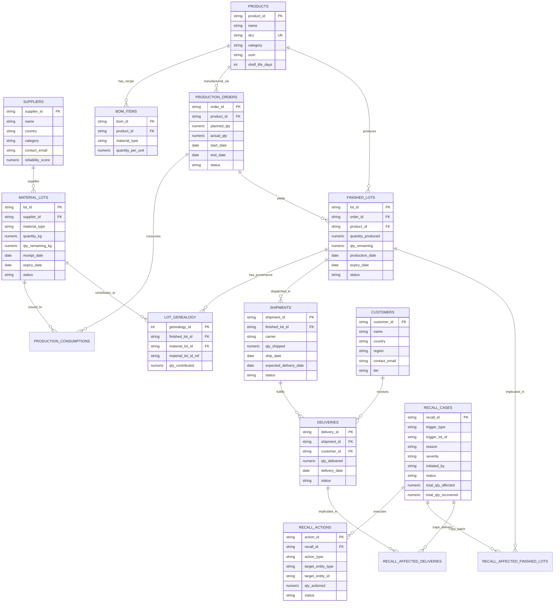

# Entity-Relationship Diagram (ERD): YottaFlex SCM

**Project:** YottaFlex Supply Chain Traceability and Recall Management System  
**Seed Reference:** `20261022`

---

## 1. Relational Entity Architecture

The diagram below illustrates the end-to-end data model tracing from raw materials to final customer deliveries and the overlying recall management system.

---

## 2. Cardinality & Relationship Dynamics

1. **Suppliers to Material Lots (1:N):** One qualified vendor delivers hundreds of material receipt lots over time.
2. **Products to BOM Items (1:N):** A finished product recipe is composed of 2 to 6 specific raw material requirements.
3. **Production Orders to Finished Lots (1:N):** Each production order yields one or more packaged output finished lots.
4. **Lot Genealogy (N:M):** Many raw material lots contribute to multiple finished lots through partial and multi-lot dispensing.
5. **Finished Lots to Shipments (1:N):** Pallets from a finished lot are partitioned across logistics carriers.
6. **Shipments to Deliveries (1:N):** A master carrier shipment is distributed to multiple customer regional distribution centers.
7. **Recall Cases to Interventions (1:N):** A single recall case coordinates notifications, warehouse quarantines, and physical retrievals.
