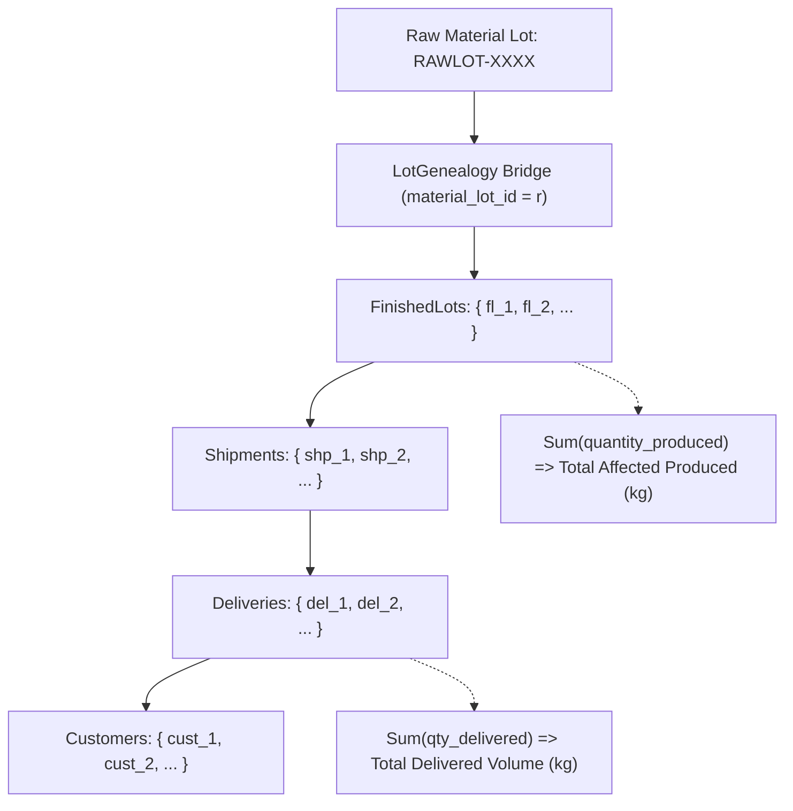
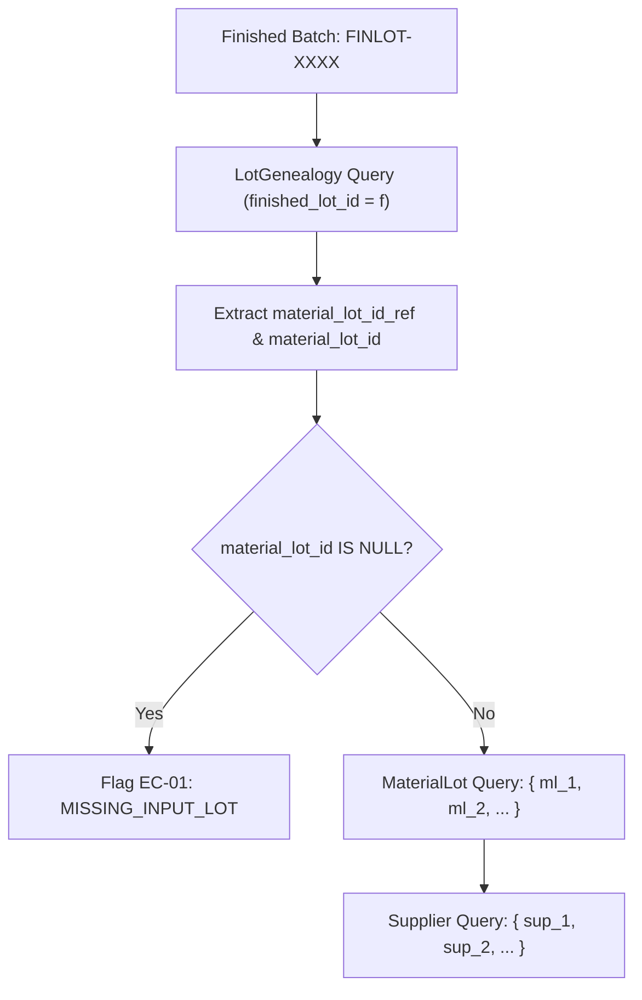

# Multi-Echelon Genealogy Traversal Engine: Architecture & Algorithm Design

**Project:** YottaFlex Supply Chain Traceability and Recall Management System  
**Seed Reference:** `20261022`

---

## 1. Graph Theoretical Formulation

The YottaFlex supply chain network is modeled as a directed acyclic bipartite graph \( G = (V, E) \) where nodes \( V \) represent physical or commercial entities across six echelons:

\[
V = V_{\text{supplier}} \cup V_{\text{material\_lot}} \cup V_{\text{order}} \cup V_{\text{finished\_lot}} \cup V_{\text{shipment}} \cup V_{\text{delivery}} \cup V_{\text{customer}}
\]

Directed edges \( E \) represent material transformations, inventory allocations, or logistics dispatch operations:
- \( (u, v) \in E_{\text{supply}} \subset V_{\text{supplier}} \times V_{\text{material\_lot}} \)
- \( (u, v) \in E_{\text{consume}} \subset V_{\text{material\_lot}} \times V_{\text{order}} \)
- \( (u, v) \in E_{\text{yield}} \subset V_{\text{order}} \times V_{\text{finished\_lot}} \)
- \( (u, v) \in E_{\text{genealogy}} \subset V_{\text{material\_lot}} \times V_{\text{finished\_lot}} \)
- \( (u, v) \in E_{\text{ship}} \subset V_{\text{finished\_lot}} \times V_{\text{shipment}} \)
- \( (u, v) \in E_{\text{deliver}} \subset V_{\text{shipment}} \times V_{\text{delivery}} \)
- \( (u, v) \in E_{\text{receive}} \subset V_{\text{delivery}} \times V_{\text{customer}} \)

---

## 2. Forward Traversal Algorithm (Downstream Scope)

### 2.1 Problem Definition
Given a contaminated or suspect raw material lot \( r \in V_{\text{material\_lot}} \), determine the set of all downstream reachable finished batches \( \mathcal{F}(r) \), carrier shipments \( \mathcal{S}(r) \), deliveries \( \mathcal{D}(r) \), and commercial customer accounts \( \mathcal{C}(r) \).

### 2.2 Algorithm Flow


### 2.3 Traversal Implementation
```python
def trace_downstream_from_material_lot(db: Session, raw_lot_id: str) -> Dict[str, Any]:
    # 1. Identify finished lots via LotGenealogy bridge
    finlot_ids = db.execute(
        select(LotGenealogy.finished_lot_id)
        .where(
            (LotGenealogy.material_lot_id == raw_lot_id) | 
            (LotGenealogy.material_lot_id_ref == raw_lot_id)
        )
    ).scalars().all()

    # 2. Query finished lots
    finlots = db.execute(select(FinishedLot).where(FinishedLot.lot_id.in_(finlot_ids))).scalars().all()

    # 3. Query shipments
    shipments = db.execute(select(Shipment).where(Shipment.finished_lot_id.in_(finlot_ids))).scalars().all()
    shipment_ids = [s.shipment_id for s in shipments]

    # 4. Query deliveries & customers
    deliveries = db.execute(select(Delivery).where(Delivery.shipment_id.in_(shipment_ids))).scalars().all()
    customer_ids = list(set(d.customer_id for d in deliveries))
    customers = db.execute(select(Customer).where(Customer.customer_id.in_(customer_ids))).scalars().all()

    return {
        "trigger_lot_id": raw_lot_id,
        "affected_finished_lots": finlots,
        "affected_shipments": shipments,
        "affected_deliveries": deliveries,
        "affected_customers": customers,
    }
```

---

## 3. Backward Traversal Algorithm (Upstream Provenance)

### 3.1 Problem Definition
Given a customer quality defect or compromised finished batch \( f \in V_{\text{finished\_lot}} \), identify all input raw material receipt lots \( \mathcal{R}(f) \), quantities contributed, and upstream vendor nodes \( \mathcal{V}(f) \).

### 3.2 Algorithm Flow


### 3.3 Traversal Implementation
```python
def trace_upstream_from_finished_lot(db: Session, finished_lot_id: str) -> Dict[str, Any]:
    flot = db.execute(select(FinishedLot).where(FinishedLot.lot_id == finished_lot_id)).scalar_one_or_none()
    genealogy_records = db.execute(
        select(LotGenealogy).where(LotGenealogy.finished_lot_id == finished_lot_id)
    ).scalars().all()

    raw_lot_refs = [g.material_lot_id_ref for g in genealogy_records]
    raw_lots = db.execute(select(MaterialLot).where(MaterialLot.lot_id.in_(raw_lot_refs))).scalars().all()
    supplier_ids = list(set(r.supplier_id for r in raw_lots))
    suppliers = db.execute(select(Supplier).where(Supplier.supplier_id.in_(supplier_ids))).scalars().all()

    return {
        "finished_lot_id": finished_lot_id,
        "ingredients": genealogy_records,
        "raw_material_lots": raw_lots,
        "suppliers": suppliers,
    }
```

---

## 4. Complex Material Transformation Scenarios

### 4.1 Partial Consumption & Split Lots
A single raw material lot \( r \) with received weight \( 1,000 \text{ kg} \) is dispensed across 3 independent production orders:
- \( \text{WO-01} \): consumes \( 350 \text{ kg} \)
- \( \text{WO-02} \): consumes \( 400 \text{ kg} \)
- \( \text{WO-03} \): consumes \( 250 \text{ kg} \)

The traversal engine captures every split branch. A recall on \( r \) correctly identifies all 3 work orders and their downstream distributions.

### 4.2 Multi-Ingredient Blending
A finished batch of beverage or baked product incorporates 4 distinct raw material lots. The `LotGenealogy` table preserves individual ingredient weights. If any one ingredient is compromised, the entire finished batch is caught in the recall net.

### 4.3 Missing Relationship Detection (EC-01)
If an ERP synchronizer creates a finished lot referencing `material_lot_id_ref = "RAWLOT-GHOST-999"`, but the supplier receipt record failed to replicate, `material_lot_id` is set to `NULL`. The traversal engine flags `is_missing_in_db = True`, immediately exposing the broken upstream link.
