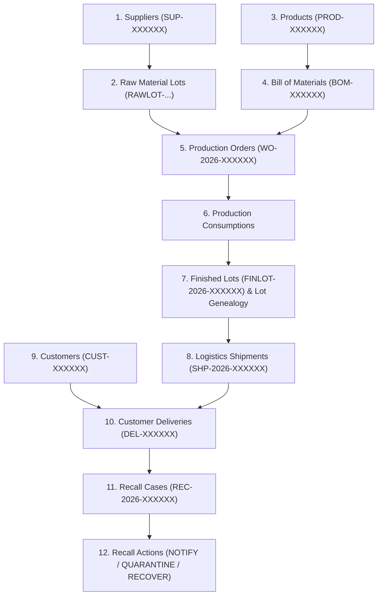

# Synthetic Data Generator Guide & Reproducibility Protocol

**Project:** YottaFlex Supply Chain Traceability and Recall Management System  
**Fixed Seed:** `20261022`

---

## 1. Generation Architecture & Philosophy

The YottaFlex Synthetic Data Generator creates realistic, production-scale supply chain datasets with:
- **Foreign-Key Integrity:** Parent records are strictly generated before dependent child records.
- **Physical Balance Preservation:** Material issued in production consumptions strictly respects available raw lot receipts; finished lot production volumes correspond to actual BOM recipes.
- **Deterministic Reproducibility:** Every random operation uses Python's standard `random.Random(seed)` and `Faker.seed(seed)`. Two runs with identical seeds produce byte-for-byte identical output datasets.
- **Volume Scaling:** Supports `starter`, `medium`, and `full` scale modes without modifying generation logic.

---

## 2. Target Volume Scales

| Entity | Starter Scale | Medium Scale | Full Production Scale (Mandatory) |
|---|---|---|---|
| **Suppliers** | 20 | 100 | **500** |
| **Raw Material Lots** | 150 | 2,000 | **10,000** |
| **Products (SKUs)** | 10 | 25 | **50** |
| **BOM Recipe Items** | ~44 | ~100 | **~200** |
| **Production Orders** | 50 | 1,000 | **5,000** |
| **Finished Lots** | 80 | 1,600 | **8,000** |
| **Lot Genealogy Bridge** | ~360 | ~7,000 | **~32,000** |
| **Customers** | 30 | 200 | **1,000** |
| **Carrier Shipments** | 150 | 3,000 | **15,000** |
| **Customer Deliveries**| 200 | 4,000 | **20,000** |
| **Recall Cases** | 2 | 5 | **10** |
| **Injected Exceptions**| 4 | 4 | **4 (EC-01 .. EC-04)** |

---

## 3. Strict 12-Stage Generation Sequence



1. **Suppliers:** Generates approved corporate vendor entities across chemical, ingredient, and packaging categories.
2. **Raw Material Lots:** Generates receipt batches linked to valid `supplier_id` with receipts in early 2026.
3. **Products:** Generates commercial catalog SKUs, standard shelf lives, and categories.
4. **BOM Items:** Formulates multi-ingredient recipes linking raw material categories to products.
5. **Production Orders:** Schedules manufacturing runs per product recipe.
6. **Production Consumption:** Simulates physical dispensing of material lots into production runs.
7. **Finished Lots & Genealogy:** Yields manufactured batches and establishes N:M `LotGenealogy` records.
8. **Shipments:** Creates carrier dispatches for manufactured batches.
9. **Customers:** Creates corporate commercial retail accounts with regions and contact emails.
10. **Deliveries:** Dispatches carrier shipments to customer destinations.
11. **Recall Cases:** Simulates quality containment events triggering downstream graph traversals.
12. **Recall Actions:** Logs interventions (`NOTIFY`, `QUARANTINE`, `RECOVER`).
13. **Edge Case Injection:** Separately injects EC-01, EC-02, EC-03, and EC-04 anomalies and records isolated ground truth.

---

## 4. Execution Commands

### Generate Full Scale Dataset
```bash
python generate_data.py --scale full
```
Outputs are written to `exports/csv/`, `exports/json/`, `exports/sql/seed.sql`, and `exports/ground_truth/`.

### Run Dual-Seed Reproducibility Verification
```bash
python generate_data.py --verify --scale starter
```
Executes two independent pipeline runs with seed `20261022` and verifies that row counts, primary keys, and MD5 / SHA-256 checksums match 100%.
