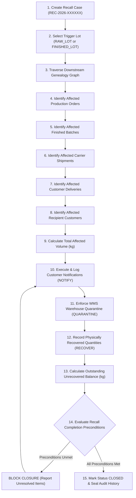

# Safety Recall Lifecycle & Operational Workflow Specification

**Project:** YottaFlex Supply Chain Traceability and Recall Management System  
**Seed Reference:** `20261022`

---

## 1. Statutory & Operational Objectives

The YottaFlex Recall Management Engine automates the 15-step regulatory and statutory lifecycle mandated for food, beverage, chemical, and pharmaceutical supply chain operations. 

Recall calculations are derived strictly through dynamic graph traversal over live database tables. Recalls are prevented from premature closure while unquarantined warehouse inventory or unnotified recipient customers remain unresolved.

---

## 2. The 15-Step Recall Lifecycle Workflow



---

## 3. Step-by-Step Execution Protocol

### Step 1: Create a Recall Case
- Initiated by the Quality Safety Directorate via `POST /api/recalls`.
- Assigns a deterministic, unique identifier following standard `REC-2026-XXXXXX`.
- Sets initial lifecycle state to `status = 'OPEN'`.

### Step 2: Select Contaminated Trigger Lot
- Determines `trigger_type`:
  - `RAW_LOT`: Contaminated supplier receipt lot (chemical, allergen, pathogen).
  - `FINISHED_LOT`: Defective packaging, failed quality check, or customer report.
- Assigns `severity`: `CLASS_I` (lethal/urgent), `CLASS_II` (temporary health), or `CLASS_III` (regulatory violation).

### Step 3: Traverse Downstream Genealogy
- Calls `GenealogyEngine.trace_downstream_from_material_lot` or `trace_downstream_from_finished_lot`.
- Explores all reachable paths through the acyclic supply chain graph without artificial scope limits.

### Step 4: Identify Affected Production Orders
- Queries all work orders that consumed the compromised material lot via `production_consumptions`.

### Step 5: Identify Affected Finished Lots
- Gathers all finished lots manufactured from affected work orders.
- Records entries in `recall_affected_finished_lots` join table with batch weight in scope.

### Step 6: Identify Affected Shipments
- Isolates all carrier bills of lading that dispatched pallets belonging to affected finished lots.

### Step 7: Identify Affected Deliveries
- Queries customer delivery receipts tied to affected shipments.
- Records entries in `recall_affected_deliveries` join table.

### Step 8: Identify Affected Customers
- Extracts distinct recipient customer account IDs from affected deliveries.
- Retrieves emergency quality contact emails and customer account tier.

### Step 9: Calculate Affected Quantities
- Aggregates physical produced volume across in-scope finished lots.
- Populates `recall_cases.total_qty_affected` in kilograms.

### Step 10: Record Customer Notifications
- Dispatches emergency safety communications to each customer account.
- Inserts an immutable event in `recall_actions`:
  ```sql
  INSERT INTO recall_actions (action_id, recall_id, action_type, target_entity_type, target_entity_id, status)
  VALUES ('ACT-000001', 'REC-2026-000001', 'NOTIFY', 'CUSTOMER', 'CUST-000001', 'COMPLETED');
  ```

### Step 11: Quarantine Affected Inventory
- Applies automated hold in warehouse management system (WMS).
- Updates finished batch lifecycle: `UPDATE finished_lots SET status = 'QUARANTINED'`.
- Logs `action_type = 'QUARANTINE'` in `recall_actions`.

### Step 12: Record Recovered Quantities
- Records returned inventory pallets received from customer locations or warehouse disposals.
- Logs `action_type = 'RECOVER'` with `qty_actioned`.
- Increments `recall_cases.total_qty_recovered`.
- Transitions recall status: `status = 'IN_PROGRESS'`.

### Step 13: Calculate Outstanding Quantities
- Calculates remaining suspect volume in circulation:
  \[
  \text{Outstanding Balance (kg)} = \max(0, \text{total\_qty\_affected} - \text{total\_qty\_recovered})
  \]

### Step 14: Evaluate Recall Completion Preconditions
Prior to allowing `status = 'CLOSED'`, `RecallEngine.evaluate_recall_completion` verifies:
1. **Zero Unquarantined Stock:** Every in-scope finished lot with positive remaining stock must have `status == 'QUARANTINED'`. (Detects EC-04).
2. **100% Notification Coverage:** Every distinct customer who received an affected delivery must have a registered `NOTIFY` action. (Detects EC-03).
3. **Reconciliation Audit:** Outstanding quantities are verified and documented.

### Step 15: Preserve Complete Action History
- Sets `closed_at = now()`.
- Transitions lifecycle: `status = 'CLOSED'`.
- Preserves all rows in `recall_actions` for regulatory audit inspection.
